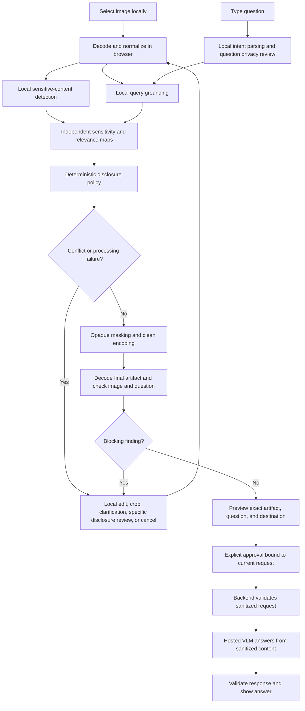

# Architecture and contracts

## System boundary

The web app is the primary product. The browser owns the original image and all unapproved analysis. A thin backend owns provider credentials and forwards a reviewed sanitized request to a hosted VLM. No GPU redaction backend is part of the accepted product architecture.

The browser is a genuine local execution environment, but available memory, runtime operators, and hardware acceleration vary. Before committing to any model, demonstrate its local execution in a browser on declared target devices. Wrapping the UI later does not automatically provide native inference or NPU support.

## End-to-end flow



The simplified diagram's review loop must invalidate earlier analysis when its inputs change. A policy-approved sensitive field remains visible in the preview and disclosure summary. Final checks compare against that explicit local disclosure policy instead of silently treating every residual sensitive field as authorized.

## Components

| Component | Runs where | Responsibilities |
| --- | --- | --- |
| Session controller | Browser | Own state, cancellation, versions, approval, and reset |
| Image decoder | Browser worker where supported | Decode, apply orientation, retain coordinate transforms, reject unsupported content |
| Query parser | Browser | Extract task and target without delegating policy authority to a hosted model |
| Text analyzer | Browser | OCR, coordinates, local entity classification, patterns and uncertainty |
| Visual analyzer | Browser | Supported faces/codes/documents and target-object detection |
| Grounding adapter | Browser | Associate question targets with regions and supporting context |
| Policy engine | Browser | Resolve relevance versus sensitivity at field/region level |
| Sanitizer | Browser | Conservative mask geometry, opaque rendering, metadata-free output |
| Output checker | Browser | Inspect final decoded file and outgoing question under the disclosure policy |
| Review UI | Browser | Exact preview, conflicts, corrections, destination, approval |
| VLM API adapter | Backend | Validate payloads, keep credentials private, select pinned destination, call provider |
| Evaluation harness | Separate research workflow | Controlled datasets, baselines, metrics, manifests, approved research calls |

Avoid a hosted LLM for raw question parsing by default: a question may itself contain PII. Rules or a small local model can produce a constrained intent schema. The hosted VLM sees only the approved outgoing question.

## Image analysis and geometry

Normalize orientation before detecting or masking. Maintain explicit transforms between original decoded pixels, detector inputs, crops, and preview pixels. Keep masks in one canonical image coordinate system. Recompute or transform them after edits and validate clipping, rotation, and scale.

OCR supplies words/lines with polygons and confidence. A local entity layer identifies relevant sensitive spans, using appropriate patterns, context, or a small NER model. Private text can span multiple OCR tokens, lines, or low-confidence boxes. Group and expand masks conservatively. Face and code boxes must include the full protected area, not only visible landmarks or code centers.

Grounding finds task evidence. Segmentation refines object masks when useful and feasible, but OCR polygons and conservative boxes can be sufficient for selected tasks. Do not require a heavy segmentation model to mask a name. Never turn a relevance box into an automatic permission to disclose all its contents.

## Local data contracts

Define actual TypeScript schemas during implementation. These are proposed shapes, with no dependency or endpoint currently implemented:

```ts
type Region = {
  id: string;
  polygon: Array<{ x: number; y: number }>; // canonical image pixels
  category: string;
  confidence?: number; // detector-specific, not probability of safety
  sourceModel: string;
};

type LocalAnalysis = {
  jobId: string;
  inputVersion: number;
  sensitiveRegions: Region[];
  relevantRegions: Region[];
  conflicts: Array<{ regionId: string; reasonCode: string }>;
  stageStatus: Record<string, "complete" | "failed" | "unsupported">;
  // Detailed OCR and original question, if needed, are local-only fields.
};

type ReviewedArtifact = {
  jobId: string;
  inputVersion: number;
  image: Blob; // final clean encoded file used by the preview
  outgoingQuestion: string;
  destination: { provider: string; model: string };
  policyVersion: string;
  checkVersion: string;
  approvedSensitiveRegionIds: string[]; // local only
  checkResult: "ready_for_review" | "blocked";
  localDigest: string; // local only, binds exact content and destination
};
```

Do not pass a generic object that can accidentally include originals, detailed OCR, private labels, or crops into the upload client. Construct the upload payload explicitly from allowed fields.

## Backend API

Proposed endpoint: `POST /api/answer`, after the local approval gate. Start with one fixed configured provider/model and no arbitrary remote URLs. Use a bounded multipart request or another explicitly selected bounded transport:

| Request field | Meaning |
| --- | --- |
| `image` | Final encoded sanitized bytes, with a generic filename |
| `question` | Exact approved outgoing question |
| `modelKey` | Server-side allowlisted model configuration key |
| `policyVersion` | Non-content version identifier |
| `requestId` | Random per-request identifier, not a content hash or persistent user ID |

The server validates size, media type, actual decodability, dimensions, question length, model allowlist, and abuse limits. It rejects invalid input without echoing content. The client and server agree on limits before preview. No post-approval crop or resize may silently change the outgoing image.

Proposed response:

```ts
type AnswerResponse = {
  requestId: string;
  answer: string;
  abstained: boolean;
  reasonCode?: string;
  modelKey: string;
  modelRevision?: string; // report only if the provider actually exposes it
  providerLatencyMs?: number;
};
```

Suggested content-free error codes include `INVALID_REQUEST`, `UNSUPPORTED_MEDIA`, `PAYLOAD_TOO_LARGE`, `RATE_LIMITED`, `PROVIDER_UNAVAILABLE`, `PROVIDER_TIMEOUT`, and `INVALID_MODEL_RESPONSE`. Do not include the original provider exception or request body in client errors or logs.

The backend cannot verify that an arbitrary request came through a correctly operating local sanitizer. Approval digests prevent accidental mismatches inside the app; they do not prove client behavior to the server. Keep this limitation explicit.

## State machine and race protection

Use explicit states: `empty`, `loading_models`, `ready`, `analyzing`, `review_required`, `sanitizing`, `checking`, `preview_ready`, `approved`, `sending`, `answered`, `blocked`, `failed`, and `canceled`.

Only `approved` for the current artifact may transition to `sending`. Any relevant input change increments the input version, cancels stale jobs, clears approval, and returns to analysis or review. Completion handlers must compare job/version before committing results. Cancel/reset must prevent a late response from restoring cleared content. Prevent double sends. Network retries reuse only the exact approved sanitized request and destination.

## Framework and module layout

Provisional implementation default: TypeScript, React with Vite, local analysis workers, and a small TypeScript backend. Next.js is an acceptable alternative after recording the choice, provided original-image code never executes on or serializes to the server. No framework is installed yet.

Use separate modules for `session`, `image`, `analysis`, `policy`, `sanitize`, `verify`, and `vlm-client`; keep provider adapters server-only. Directory names are proposed and should match the selected scaffold. Model adapters must expose capabilities and failure status instead of silently falling back to cloud analysis.

Keep weights versioned in manifests, load them lazily, and distinguish first download from warm inference. Use workers for heavy work and release resources. WASM fallback is allowed only if its model support and resource use are acceptable. Otherwise, block upload with a clear explanation.

## Extension boundaries

For voice, add local recording/transcription and apply the same question review. Do not assume the browser's speech API keeps audio local. For video, redetect and track masks with scene-change/lost-tracking handling and gate every transmitted frame. A still-image approval never authorizes an unreviewed stream. For wrappers, reuse UI and contracts while adding validated native adapters. Offline answering and inpainting are independent later capabilities.
